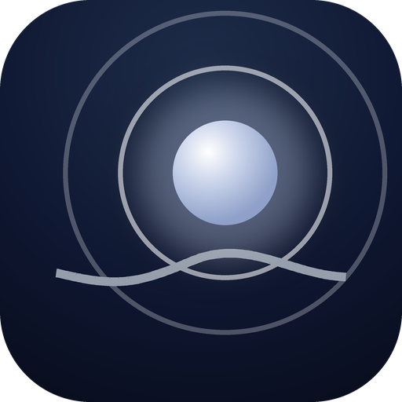
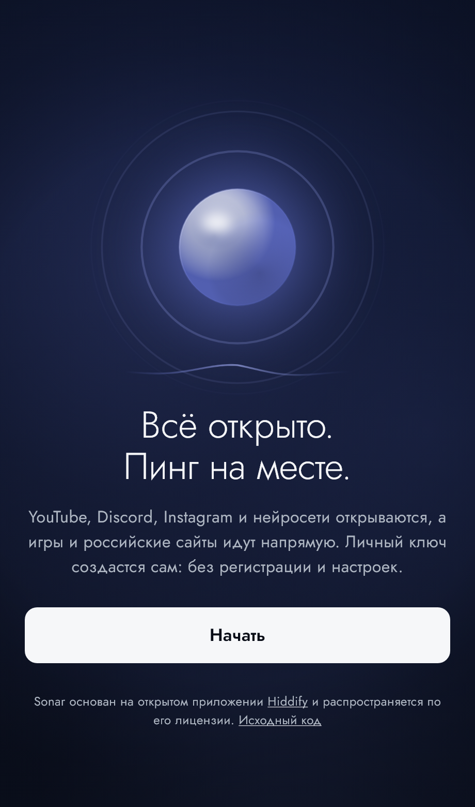
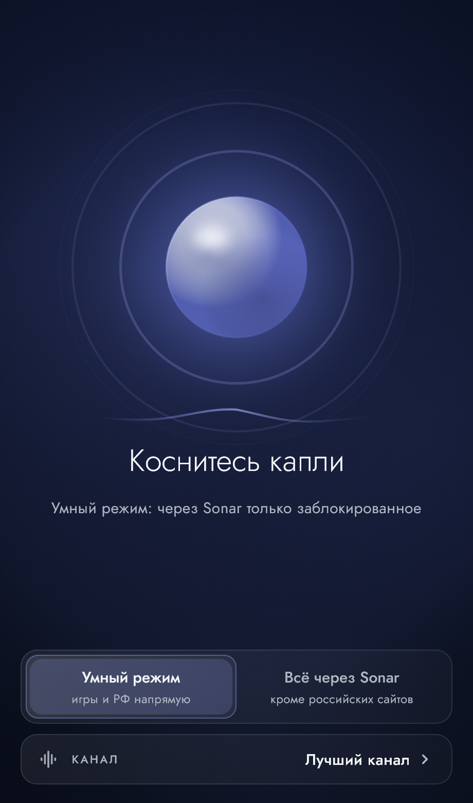
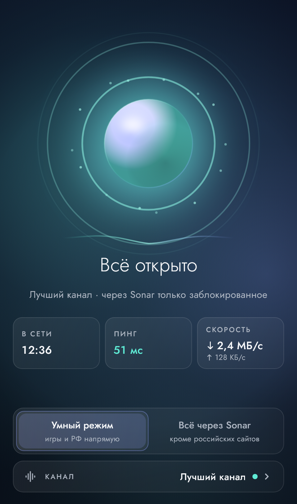
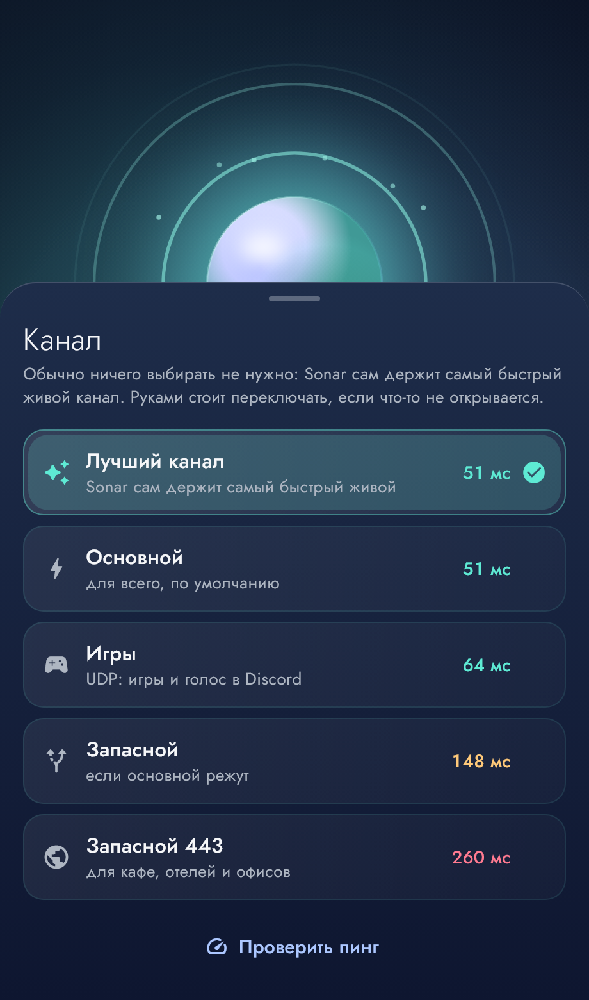

<div align="center">



# Sonar

**Всё открыто. Пинг на месте.**

Приложение частного VPN Sonar для Windows, Android, Linux и macOS.
Сайт: [sonar-vpn.vercel.app](https://sonar-vpn.vercel.app)

[Скачать последнюю версию](https://github.com/niyazvinskiy/sonar-app/releases/latest)

</div>

<table>
<tr>
<td></td>
<td></td>
<td></td>
<td></td>
</tr>
</table>

## Что умеет

- **Одна кнопка.** После установки нажмите «Начать»: личный ключ выдаётся сам, без регистрации, и Sonar сразу подключается.
- **Умный режим.** Через сервер идёт только заблокированное в России и закрытое для России (нейросети, Spotify, Netflix). Игры и российские сайты идут напрямую, поэтому пинг в них не меняется. Второй режим, «Всё через Sonar», включается одной кнопкой.
- **Четыре канала и автовыбор.** Основной (VLESS + Reality), Игры (Hysteria 2 по UDP), Запасной и Запасной 443 (XHTTP). Приложение само выбирает лучший живой канал.
- **Обновляется само.** Новая версия ищется при запуске и раз в 6 часов, скачивается в фоне. На Windows и Linux ставится без вопросов, на Android система попросит одно касание «Установить». Настройки серверов обновляются подпиской.

## Чем отличается от Hiddify

Sonar это форк [Hiddify](https://github.com/hiddify/hiddify-app). Изменения:

| Что | Где |
|---|---|
| Главный экран со сферой, режимами и каналом | `lib/sonar/sonar_home.dart`, `lib/sonar/sonar_sphere.dart` |
| Первый запуск с кнопкой «Начать» и выдачей ключа | `lib/sonar/sonar_intro.dart`, `lib/sonar/sonar_key.dart`, `lib/sonar/sonar.dart` |
| Автообновление из релизов этого репозитория | `lib/sonar/sonar_updater.dart` |
| Правила умного режима на списках runetfreedom | `lib/features/route_rules/notifier/rules_notifier.dart` |
| Регион Россия, DNS Яндекса для прямых сайтов, тёмная тема | `config_option_repository.dart`, `app_theme.dart` |
| Имя, иконки, идентификаторы `app.sonar.vpn`, установка Windows в профиль пользователя | `android/`, `windows/`, `linux/`, `scripts/sonar_icons.py` |
| Сборка и релизы в GitHub Actions | `.github/workflows/build.yml` |

## Сборка

Релиз собирается сам при теге `sonar-vX.Y.Z` (теги `v…` заняты историей Hiddify), версия в `pubspec.yaml` должна совпадать:

```bash
git tag sonar-v1.0.1 && git push origin sonar-v1.0.1
```

Секреты репозитория:

| Секрет | Зачем |
|---|---|
| `SONAR_API` | адрес выдачи ключей (`vpnctl api` на сервере) |
| `ANDROID_SIGNING_KEY` | ключ подписи Android в base64; без постоянного ключа обновление не встанет поверх |
| `ANDROID_SIGNING_STORE_PASSWORD`, `ANDROID_SIGNING_KEY_PASSWORD`, `ANDROID_SIGNING_KEY_ALIAS` | пароли и имя ключа |

Иконки всех платформ рисуются скриптом: `python scripts/sonar_icons.py`.

## Лицензия

Sonar распространяется по лицензии Hiddify: GPLv3 с дополнительными условиями ([LICENSE.md](LICENSE.md)).
Исходный проект: [hiddify/hiddify-app](https://github.com/hiddify/hiddify-app). Некоммерческое использование.
